<!--
RED CAVALARY — GitHub Profile README
Upload README.md and the complete assets/ folder to the public repository named RedCavalary.
Back up existing files before replacing them.
-->

  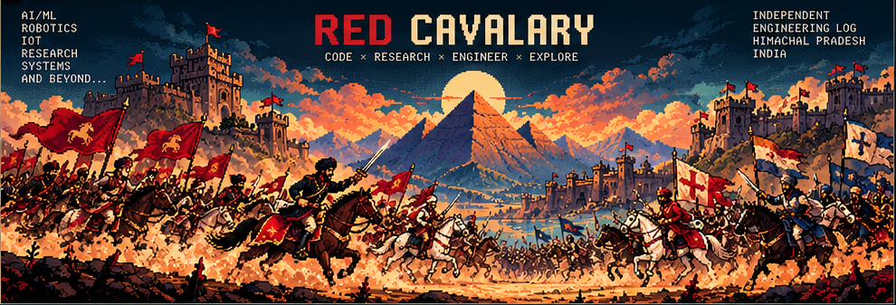

  <h1>RED CAVALARY_</h1>
  
<b>CODE × RESEARCH × ENGINEER × EXPLORE</b>

  
<i>Code is the weapon. Research is the map. Build things that hold up in the real world.</i>

  
<a href="https://github.com/RedCavalary?tab=repositories">EXPLORE THE CAMPAIGNS ↗</a> &nbsp;·&nbsp; <a href="https://github.com/RedCavalary">OPEN GITHUB ↗</a>

  
<code>INDEPENDENT ENGINEERING LOG</code> · <code>HIMACHAL PRADESH · INDIA</code>

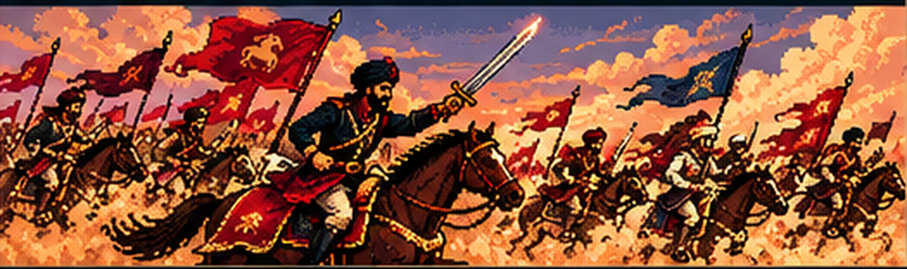

<code>STRATEGY · SYSTEMS · IMPACT ✣</code>

---

## 01 / COMMANDER'S LOG

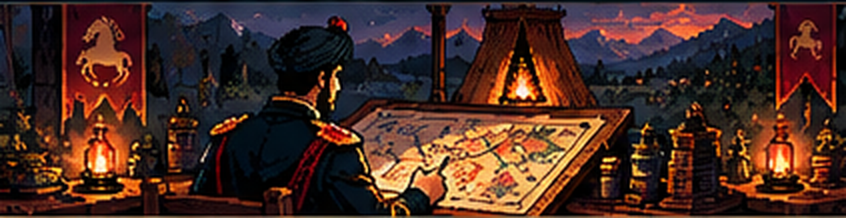

### Curiosity first. Engineering always.

I'm **Uday Thakur**, a computer science engineering student exploring the space where **AI, software, and physical systems** meet. I like taking ideas from a rough sketch to a working prototype—and then asking what would make it more reliable.

This is my public field log: selected builds, experiments, research, and the tools I use to make them real.

`AI/ML` · `COMPUTER VISION` · `EMBEDDED SYSTEMS` · `RESEARCH` · `SOFTWARE ENGINEERING`

## 02 / ACTIVE CAMPAIGNS

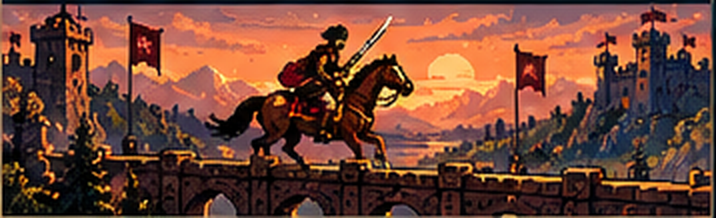

Different problems. One approach: understand the terrain, then build.

<table>
  <tr>
    <td width="50%" valign="top">
      <h3>MISSION 001 / CYBER-PHYSICAL</h3>
      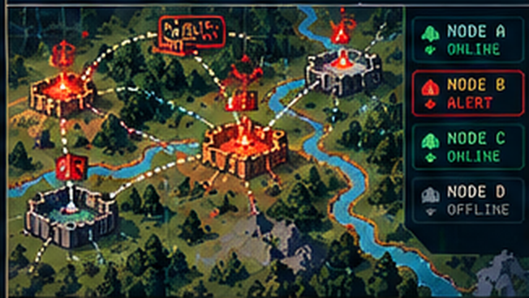
      <h3>Dam Alert Digital Twin</h3>
      Simulation environment for a remote flood-warning network, with virtual nodes, authenticated messaging, AES-GCM encryption, and replay protection.
      
<code>Python</code> <code>FastAPI</code> <code>Cryptography</code> <code>ESP32</code>

      <a href="https://github.com/RedCavalary?tab=repositories">EXPLORE REPOSITORIES ↗</a>
    </td>
    <td width="50%" valign="top">
      <h3>MISSION 002 / AI AUTOMATION</h3>
      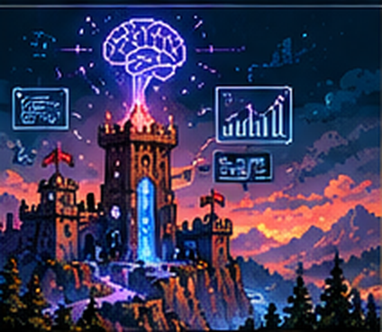
      <h3>Lead Scorer API</h3>
      An AI-agent project focused on scoring Salesforce leads and helping prioritize sales workflows.
      
<code>Python</code> <code>API</code> <code>AI Agents</code>

      <a href="https://github.com/RedCavalary/lead-scorer-api">OPEN REPOSITORY ↗</a>
    </td>
  </tr>
  <tr>
    <td width="50%" valign="top">
      <h3>MISSION 003 / BIOMEDICAL AI</h3>
      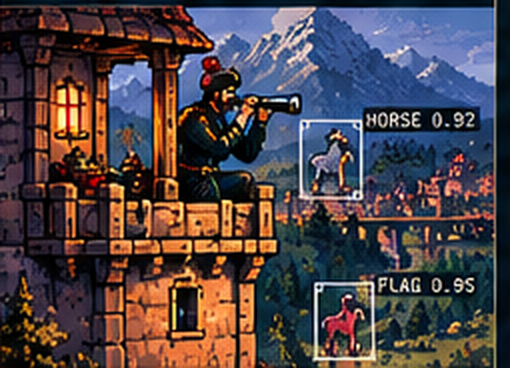
      <h3>ECG Machine Learning</h3>
      Machine-learning workflows for ECG signals, from data preparation to model evaluation.
      
<code>Jupyter</code> <code>Python</code> <code>Scikit-learn</code>

      <a href="https://github.com/RedCavalary/ECG-Machine-learning">OPEN REPOSITORY ↗</a>
    </td>
    <td width="50%" valign="top">
      <h3>MISSION 004 / COMMUNICATIONS</h3>
      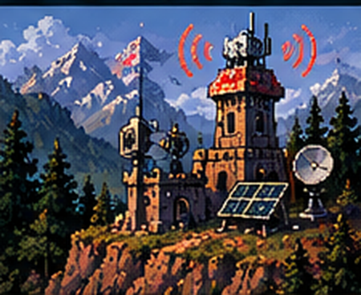
      <h3>5G MIMO Using ANN</h3>
      A neural-network approach to a wireless communications problem, connecting signal processing and machine learning.
      
<code>MATLAB</code> <code>ANN</code> <code>5G / MIMO</code>

      <a href="https://github.com/RedCavalary/5g-Mimo-using-ANN">OPEN REPOSITORY ↗</a>
    </td>
  </tr>
</table>

<a href="https://github.com/RedCavalary?tab=repositories">ALL REPOSITORIES ↗</a>

## 03 / THE ARSENAL

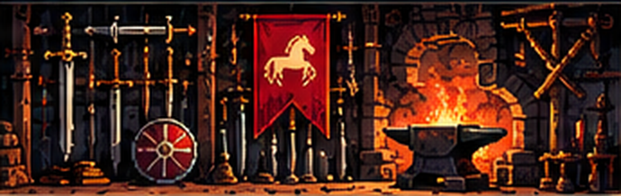

| Domain | Tools & technologies |
|---|---|
| **AI & machine learning** | PyTorch · TensorFlow · Scikit-learn · YOLO · U-Net |
| **Languages & data** | Python · C/C++ · SQL · NumPy · Pandas |
| **Computer vision** | OpenCV · Image segmentation · Object detection · Medical imaging |
| **Systems & embedded** | ESP32 · Arduino · FastAPI · Docker · Linux |
| **Data & infrastructure** | MySQL · MongoDB · Firebase · AWS · Qdrant |
| **Research & experiments** | Evaluation · Reproducibility · Simulation · Technical writing |

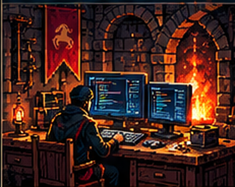

## 04 / FIELD NOTES

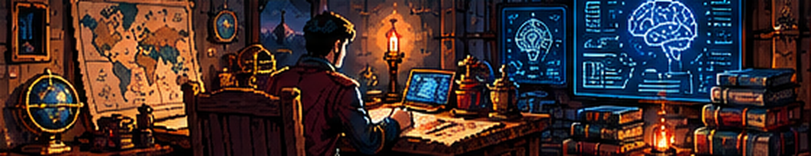

### From experiment to evidence.

My interests sit at the intersection of machine learning, computer vision, and dependable real-world systems. I value clear baselines, honest evaluation, and documenting what did—and didn't—work.

- **TATVANet** — Co-authored research on a thermal-RGB attention-based network for turmeric adulteration detection. *(Publication)*
- **Adaptive Spectrum Sensing** — Exploring temporal primary-user activity, sensing-threshold prediction, and reinforcement-learning policies. *(Research)*
- **Local-first Knowledge Systems** — Building a modular retrieval-augmented generation pipeline for Himachal Pradesh census documents. *(Build log)*

## 05 / OPEN CHANNEL

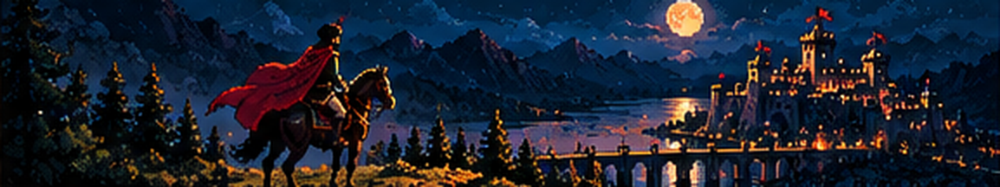

### Have a good problem? Let's build something useful.

Open to thoughtful conversations about AI/ML, research, engineering, and projects where software meets the real world.

<a href="https://github.com/RedCavalary">CONNECT ON GITHUB ↗</a> &nbsp;·&nbsp; <a href="https://orcid.org/0009-0007-7005-0926">ORCID ↗</a>

For professional contact, use the email listed on my GitHub profile.

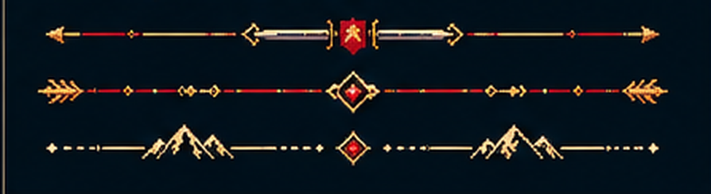

  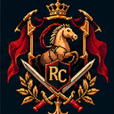
  
RC / RED CAVALARY_ · BUILT WITH CURIOSITY & PIXELS · © UDAY THAKUR

